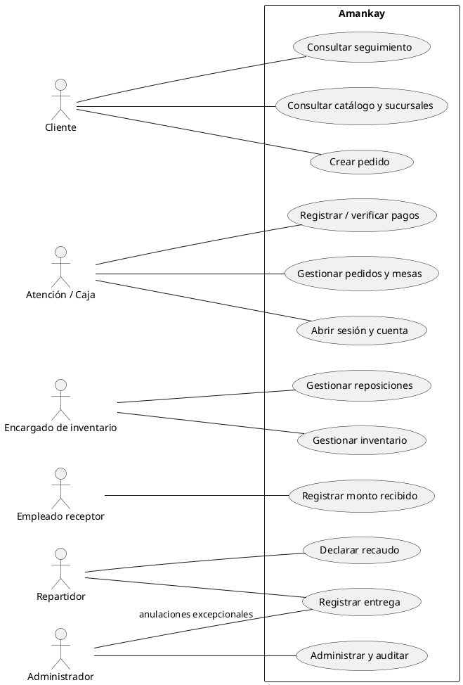
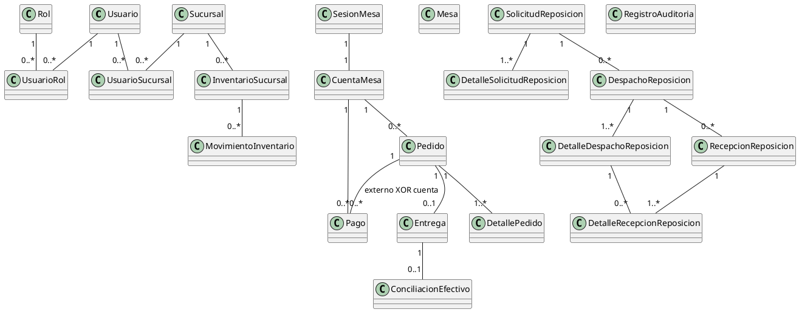

# Modelo UML de Amankay

## Estado y alcance

Este documento consolida actores, casos de uso y clases conceptuales del MVP. Las decisiones listadas aquí fueron aprobadas conjuntamente; no implica aprobación final del MER ni autorización para programar o crear la base de datos. La descripción de entidades y cardinalidades se mantiene alineada con [MER.md](MER.md).

## Actores

- **Cliente:** consulta catálogo y sucursales, realiza pedidos y consulta su seguimiento; no se exige inicio de sesión.
- **Atención/caja:** gestiona mesas y pedidos, verifica pagos, registra pagos y recibe/coordina pedidos externos.
- **Encargado de inventario:** opera inventario y reposiciones según su asociación a la sucursal solicitante o proveedora.
- **Repartidor:** usuario con rol asignado; realiza entregas y declara el recaudo entregado a sucursal.
- **Empleado autorizado de sucursal:** registra el monto recibido del repartidor.
- **Administrador:** gestiona configuración y usuarios; interviene en anulaciones excepcionales. No obtiene permisos operativos automáticamente.

Los permisos se determinan por rol y sucursal con `UsuarioRol` y `UsuarioSucursal`. No existen permisos individuales ni doble autorización obligatoria por defecto. Una misma persona puede registrar y autorizar operaciones ordinarias.

## Casos de uso por módulo

| Módulo | Casos de uso principales |
| --- | --- |
| Catálogo y sucursales | Consultar productos, categorías, precios, disponibilidad y sucursales. |
| Pedidos | Crear pedido QR, externo, domicilio o recogida; revisar/aceptar/rechazar; consultar estado; cancelar conforme al flujo aprobado; registrar manualmente pedidos de WhatsApp. |
| Mesas | Abrir sesión y cuenta conjuntamente; aceptar pedidos QR en la sesión; cerrar sesión y cuenta independientemente; cobrar saldo pendiente. |
| Pagos | Registrar intentos en efectivo o transferencia, verificar/rechazar y gestionar reembolso manual total. Máximo un comprobante por intento; cada reintento es otro `Pago`. |
| Inventario | Consultar existencias y movimientos; registrar ajustes permitidos; impedir saldos negativos. |
| Reposición | Solicitar, revisar, aprobar/rechazar, despachar parcialmente y recibir parcial o totalmente; registrar apto/dañado y cierre final de faltante por línea. |
| Entregas | Asignar repartidor, actualizar estado, registrar entrega y conciliar una vez el recaudo por entrega en efectivo. |
| Administración | Gestionar usuarios, roles, sucursales, productos, horarios, mesas y configuración; consultar reportes y auditoría administrativa. |

## Diagrama general de casos de uso

## Modelo de clases conceptual

### Entidades principales y asociativas

`Usuario`, `Rol`, `Sucursal`, `UsuarioRol`, `UsuarioSucursal`, `Categoria`, `Producto`, `InventarioSucursal`, `MovimientoInventario`, `Pedido`, `DetallePedido`, `Mesa`, `SesionMesa`, `CuentaMesa`, `Pago`, `ConciliacionEfectivo`, `Entrega`, `ConfiguracionDomicilio`, `SolicitudReposicion`, `DetalleSolicitudReposicion`, `DespachoReposicion`, `DetalleDespachoReposicion`, `RecepcionReposicion`, `DetalleRecepcionReposicion`, `HorarioSucursal`, `RegistroAuditoria`.

`UsuarioRol` y `UsuarioSucursal` son asociaciones M:N con claves compuestas por sus dos FK. No se modelan clases separadas `ComprobantePago`, `Reembolso`, `MovimientoBancario`, `Repartidor`, `DetalleCuenta` ni `CierreFaltanteReposicion`.

### Relaciones y reglas de multiplicidad

- `Usuario` M:N `Rol` por `UsuarioRol`; `Usuario` M:N `Sucursal` por `UsuarioSucursal`.
- `Sucursal` 1:N `Mesa`, `InventarioSucursal`, `HorarioSucursal` y movimientos asociados.
- `Pedido` 1:N `DetallePedido`; `Pedido` puede tener 0..1 `Entrega`, y `Entrega` pertenece a un pedido domiciliario. La sucursal responsable deriva del pedido.
- `SesionMesa` y `CuentaMesa` tienen relación obligatoria 1:1. Se crean juntas; sus cierres son independientes. No se abre otra sesión en la mesa mientras su cuenta siga abierta.
- `CuentaMesa` 1:N `Pedido` QR. `Pedido.cuentaMesaId` es obligatorio para `QR_MESA` y nulo para pedidos externos.
- `Pago` representa un intento y se relaciona con exactamente uno de `Pedido` externo o `CuentaMesa`. Contiene opcionalmente un comprobante; cada reintento es otro `Pago`.
- `Entrega` 0..1 `ConciliacionEfectivo`; conciliación tiene FK `entregaId` única. El repartidor declara el monto y el empleado autorizado de la sucursal registra lo recibido. Diferencia exige motivo; rectificación excepcional queda en `RegistroAuditoria`.
- `SolicitudReposicion` 1:N `DetalleSolicitudReposicion` y 1:N `DespachoReposicion`; despacho 1:N `DetalleDespachoReposicion`.
- `DespachoReposicion` 1:N `RecepcionReposicion`; recepción 1:N `DetalleRecepcionReposicion`. Cada detalle recibido referencia una línea despachada concreta.
- Se registra como máximo un cierre final por detalle de solicitud (antes del despacho) o detalle de despacho (después). Los datos del cierre y de una eventual reversa total se guardan en ese mismo detalle. La reversa conserva los datos originales y restaura solo el saldo que cerró; no hay entidad de cierre ni ciclos múltiples.

### Reposición, correcciones y cantidades

Estados de solicitud: `PENDIENTE_REVISION`, `RECHAZADA`, `EN_PROCESO`, `COMPLETADA`. `BORRADOR` solo se usa si el flujo requiere guardar sin enviar. Los pendientes se calculan a partir de cantidades; no se almacenan contadores duplicados.

Un despacho o recepción erróneos se corrigen mediante anulación completa cuando sus dependencias puedan gestionarse de forma segura, y registro nuevo. El evento original permanece. La anulación documental no modifica inventario automáticamente; un movimiento compensatorio es independiente y no puede generar stock negativo. Si el producto ya fue consumido, se deriva a revisión administrativa: no se reescriben ventas, ni se generan deudas, pérdidas automáticas o regularizaciones complejas.

Para `DetalleSolicitudReposicion`, pendiente de despacho = cantidad aprobada − suma enviada en despachos vigentes − cierre previo vigente. Para `DetalleDespachoReposicion`, pendiente de recepción = cantidad enviada vigente − suma recibida apta/dañada vigente − cierre posterior vigente. Un cierre revertido cuenta como cero y devuelve el saldo correspondiente; los dos tipos de cierre nunca reducen el mismo saldo.

El personal autorizado de inventario gestiona operaciones según la sucursal asociada. El administrador interviene en anulaciones excepcionales. No se exige doble autorización para operaciones ordinarias. El UML de clases resumido representa las entidades y asociaciones principales; los atributos de cierre/reversa están especificados en el MER y no introducen clase adicional.

### Diagrama de clases resumido

El diagrama es conceptual: la regla XOR de origen de `Pago`, la obligatoriedad de la cuenta en pedidos QR y otros controles entre entidades requieren restricciones y validación descritas en el MER.

## Fuentes

Las decisiones consolidadas derivan del SRS y de las once conversaciones enlazadas en su sección de trazabilidad. Este documento y el MER deben actualizarse conjuntamente ante nuevas decisiones.
